<!-- ===================================================================== -->
<!-- 01 // CYBER-HUD HERO DECK (DARK / LIGHT ADAPTIVE SVG, NATIVE 900PX)   -->
<!-- ===================================================================== -->
<picture>
  <source media="(prefers-color-scheme: dark)" srcset="./assets/hero-dark.svg" />
  <source media="(prefers-color-scheme: light)" srcset="./assets/hero-light.svg" />
  
</picture>

  

<!-- ===================================================================== -->
<!-- 02 // 2x2 BENTO ENGINEERING MATRIX (DARK / LIGHT ADAPTIVE SVG)        -->
<!-- ===================================================================== -->
<picture>
  <source media="(prefers-color-scheme: dark)" srcset="./assets/architecture-dark.svg" />
  <source media="(prefers-color-scheme: light)" srcset="./assets/architecture-light.svg" />
  
</picture>

  

<!-- ===================================================================== -->
<!-- 03 // DIRECT REPOSITORY QUICK-LINKS                                   -->
<!-- ===================================================================== -->

  <a href="https://github.com/LCorleone/pi-desktop"><b>pi-desktop</b></a> ·
  <a href="https://github.com/LCorleone/pi-wx-agent"><b>pi-wx-agent</b></a> ·
  <a href="https://github.com/LCorleone/pi-subagents"><b>pi-subagents</b></a> ·
  <a href="https://github.com/LCorleone/one-api"><b>one-api</b></a> ·
  <a href="https://github.com/LCorleone/magpie"><b>magpie</b></a> ·
  <a href="https://github.com/LCorleone/garmin-miniapp"><b>garmin-miniapp</b></a> ·
  <a href="https://github.com/LCorleone/screenshot"><b>screenshot</b></a> ·
  <a href="https://github.com/LCorleone/poker"><b>poker</b></a>

 

<!-- ===================================================================== -->
<!-- 04 // GITHUB PULSE & CONTRIBUTION TELEMETRY                           -->
<!-- ===================================================================== -->
<picture>
  <source media="(prefers-color-scheme: dark)" srcset="https://github-pulse-topaz.vercel.app/u/LCorleone?theme=dracula" />
  <source media="(prefers-color-scheme: light)" srcset="https://github-pulse-topaz.vercel.app/u/LCorleone?theme=paper" />
  
</picture>

  

<picture>
  <source media="(prefers-color-scheme: dark)" srcset="https://raw.githubusercontent.com/LCorleone/LCorleone/output/github-snake-dark.svg" />
  <source media="(prefers-color-scheme: light)" srcset="https://raw.githubusercontent.com/LCorleone/LCorleone/output/github-snake.svg" />
  
</picture>

